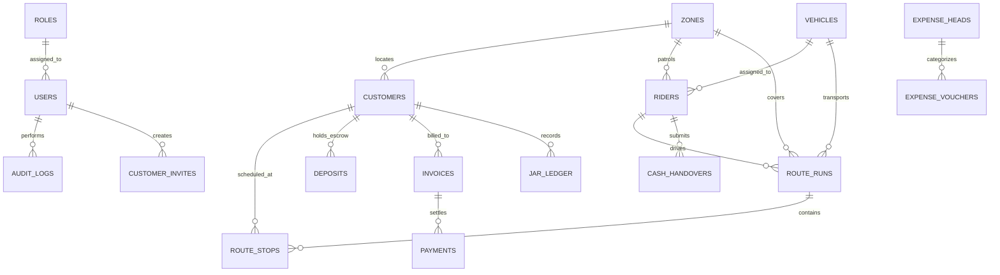

# Panniwalay ERP — Database Architecture & Schema Specification

This document details the database schema, relational model, constraints, and financial representation used across Panniwalay ERP. The schema is implemented using **Drizzle ORM** with **MySQL 8.0+** (`server/src/db/schema.ts`).

---

## 1. Entity Relationship (ER) Diagram

---

## 2. Currency & Financial Representation Rule

> [!IMPORTANT]
> **No Floating Point Arithmetic for Currency:**
> All monetary values in Panniwalay ERP (Customer deposits, invoice totals, payments, expense vouchers, and rider cash in hand) are stored strictly as **integers representing Pakistani Rupees (PKR)** using `bigint('...', { mode: 'number' })`.
> Sub-cent/fractional paisas do not circulate in physical Pakistani currency. Multi-currency conversions (USD, AED, SAR, EUR) are converted at display/reporting runtime using decimal precision `15, scale: 6`.

---

## 3. Core Database Tables & Data Dictionary

### `roles`
System access tiers (`admin`, `manager`, `dispatcher`, `accountant`, `rider`).

### `users`
Internal plant personnel with bcrypt password hashes, JWT refresh token storage, and active flags.

### `zones`
Karachi delivery zones (e.g., `Z-01` Clifton & Sea View, `Z-02` DHA Phase 5 & 6, `Z-03` Gulshan-e-Iqbal, `Z-04` PECHS, `Z-05` North Nazimabad, `Z-06` Korangi Industrial Area).

### `vehicles`
Fleet transport units (`Suzuki Bolan Pickup`, `Hyundai Shehzore H-100`, `Suzuki Ravi Loader`, `FAW Carrier`) with registration plates and 19L jar payload capacities.

### `riders`
Fleet delivery drivers with CNIC, mobile phone, security deposit held (e.g. PKR 15,000), per-jar commission rate, active GPS coordinate status, and real-time cash in hand counter.

### `customers`
Subscribers across Karachi:
- `customer_code`: Unique reference (e.g., `CUST-0491`, `CUST-KHI-4912`)
- `type`: `residential` | `corporate`
- `jar_quota`: Total 19L bottles assigned to customer
- `jars_in_circulation`: Bottles currently at client premises
- `deposit_held`: Total refundable deposit held in escrow (e.g. PKR 1,000 per jar)
- `refill_cycle`: `weekly` | `twice_weekly` | `on_call`

### `customer_invites`
Cryptographically secured onboarding links:
- `token_hash`: SHA-256 hash of random 32-byte hex token
- `expires_at`: Expiration timestamp
- `used_at`: Timestamp when registration was completed (single-use constraint)
- `preassigned_zone_id`, `preassigned_category`, `preassigned_jar_quota`

### `inventory_items`
Plant stock catalog:
- `sku`: Unique SKU identifier (e.g. `WTR-19L-FIL`, `DSP-ELEC-HC`, `CAP-55MM-100`)
- `category`: `bottled_water`, `dispensers_coolers`, `accessories`, `caps_seals_accessories`
- `in_plant_qty`: Physical count inside Plant #4 bays
- `with_clients_qty`: Physical count distributed across customer premises
- `unit_cost`: Plant cost basis
- `sale_price`: Retail or refill price
- `refundable_deposit`: Required escrow deposit for equipment

### `route_runs`
Daily scheduled delivery dispatches:
- `run_number`: e.g. `R-101`, `R-102`
- `shift`: `morning` (07:00) | `afternoon` (13:30)
- `loading_dock_bay`: Assigned plant loading bay (Bay #1 - Bay #4)
- `total_jars`: Loaded filled jars
- `delivered_jars`: Confirmed drop-offs
- `empty_jars_expected` / `empty_jars_returned`: Return shell tracking
- `cash_to_collect` / `cash_collected`: Dock cash reconciliation

### `route_stops`
Individual client delivery stop sequence inside a route run with drop-off jar count, collected empty count, and cash collected boolean.

### `deposits`
Escrow collateral ledger:
- `amount`: PKR integer
- `type`: `collect` | `refund`
- `method`: `cash`, `bank_transfer`, `online`, `cheque`
- `reference_no`: Unique transaction / receipt identifier

### `invoices` & `payments`
Customer billing cycle records and payments received via cash or bank channels.

### `expense_heads` & `expense_vouchers`
Plant accounting ledger:
- Categorized into `cogs` (water treatment salts, caps, seals, industrial electricity) and `opex` (fleet fuel, rider bonuses, maintenance).
- Enables calculation of Gross Profit, Operating Expenses, and EBITDA margin.
